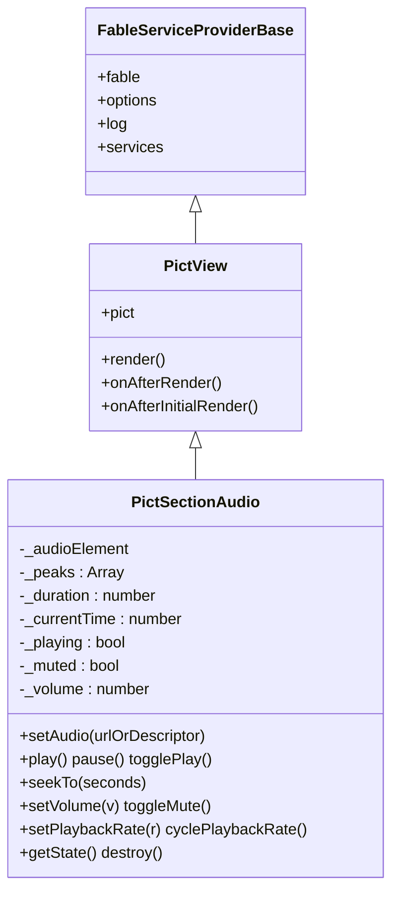
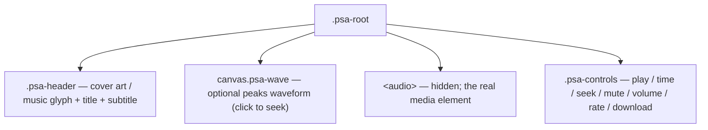
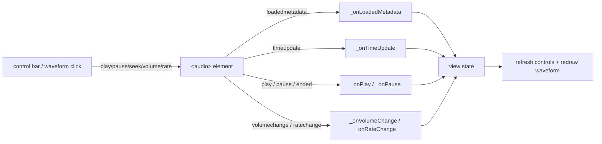

# Architecture

## Overview

`pict-section-audio` is a single [`pict-view`](https://fable-retold.github.io/pict-view/) in the lightweight
single-view shape (like `pict-section-image` / `pict-section-video`): a **stub container template**, with the
player DOM built **imperatively** in `onAfterInitialRender`. An `<audio>` element, its media events, and the peaks
`<canvas>` have no template equivalent, so they are built once as real DOM and wired with element-property
handlers.

## Class hierarchy

## Anatomy

The player is three stacked regions built into the target element:

The header and waveform are optional (`ShowArtwork`, and whether a `Peaks` array is present). Because the
presence of a waveform changes the DOM shape, `setAudio()` rebuilds the player when a track's peaks-presence
differs from the current one; otherwise it re-points the live element in place.

## The media-event loop

Like the video player, the control bar is a passive reflection of the `<audio>` element: user actions call the
element's methods, the element fires media events, and element-property handlers translate those into view state
and a control-bar + waveform refresh.

The seek slider maps its `0..1000` position onto `currentTime`; `_onTimeUpdate` maps it back, skipping the write
while the reader holds the slider so a drag is never clobbered. A click on the waveform seeks to the corresponding
fraction of the track.

## The peaks waveform

When a descriptor carries a `Peaks` array (precomputed `0..1` amplitude samples — produced server-side alongside
the file, e.g. by a rendition service), `_renderWaveform()` draws the whole waveform to a `<canvas>` in a muted
color, then redraws the played portion (up to the current time) in the accent color. It is a no-op when there are
no peaks, no 2D context (headless), or the canvas has no measurable width, so it never throws. The colors are read
from `pict-provider-theme` tokens when present, with hand-picked fallbacks otherwise.

## Event wiring, loading, and teardown

The control-bar buttons, the seek/volume `<input>`s, the waveform canvas, and the `<audio>` media events all use
**element-property handlers** — the same built-once, programmatic-element exception documented by
`pict-section-image` / `pict-section-video`. Seeking rides native HTTP **Range**, so a range-served track scrubs
without downloading the whole file. `destroy()` pauses the element, nulls every handler, removes the `src`, clears
the target, and drops all DOM references.
